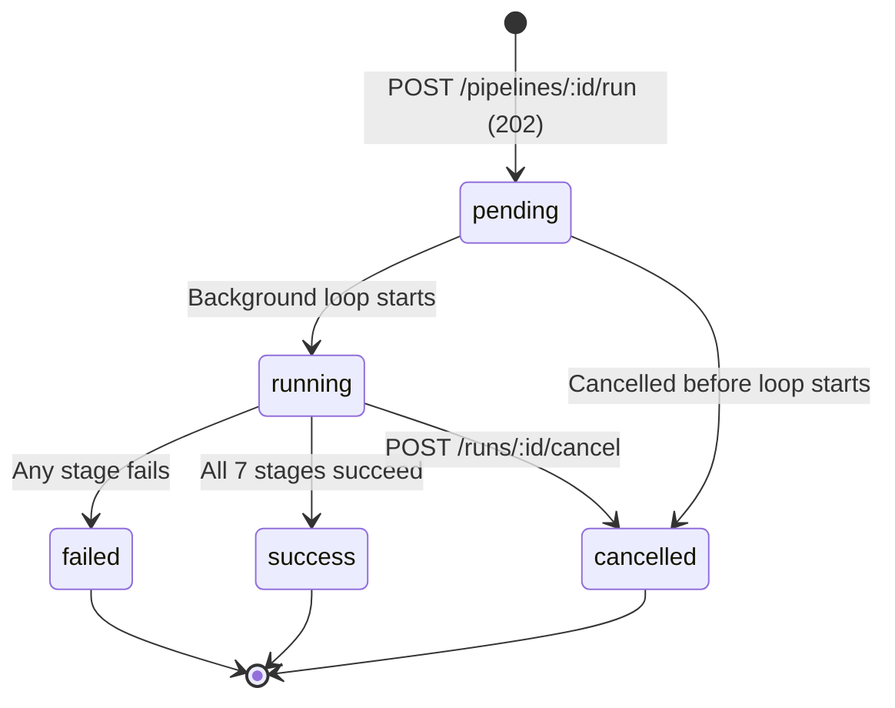
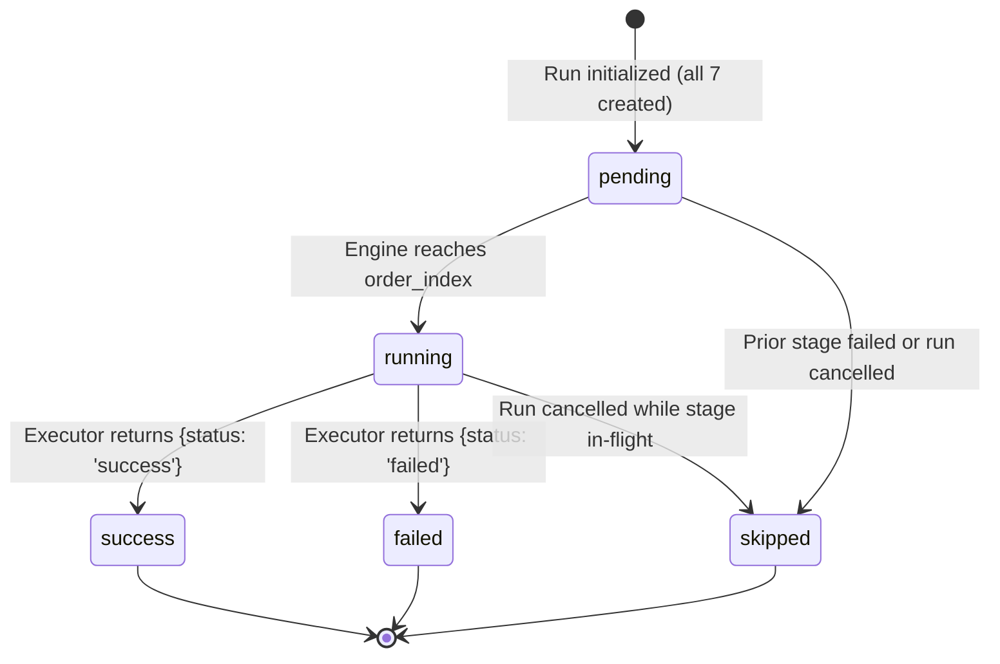

# KestrelCI Architecture & Engine Specification

**KestrelCI** is an editorial continuous integration and deployment pipeline simulation platform designed for deterministic execution, state transparency, and resilience testing.

---

## 1. System Architecture Diagram

```mermaid
graph TD
    subgraph Client ["Client Layer (React 18 + Vite SPA)"]
        UI[User Interface]
        Poll[Polling Engine (1s Interval)]
        Palette[Command Palette (Cmd+K)]
    end

    subgraph Server ["Server Layer (Node.js + Express /api/v1)"]
        Router[Express API Router]
        Auth[X-API-Key Auth Middleware]
        Validation[Zod Request Validation]
        Service[Service Orchestrator]
    end

    subgraph HybridEngine ["Hybrid Execution Engine"]
        AsyncEngine[Pipeline Engine]
        Registry[Stage Registry]
        Executors[7 Stage Executors]
        GitHubService[GitHub API Client & Analyzer]
    end

    subgraph Data ["Data Access Layer"]
        Repo[Repositories (Strict SQL Isolation)]
        SQLite[(SQLite Database - WAL Mode)]
    end

    UI -->|HTTP POST /run| Router
    Poll -->|HTTP GET /runs/:id| Router
    Router --> Auth --> Validation --> Service
    Service -->|Dispatch 202| AsyncEngine
    Service --> Repo
    AsyncEngine --> Registry --> Executors
    Executors -->|Source & Build Stages| GitHubService
    GitHubService -->|Cache Check & Storage| Repo
    AsyncEngine -->|Live Stage State & Provenance Logs| Repo
    Repo --> SQLite
```

---

## 2. Hybrid GitHub API Metadata Flow

For projects linked to a public GitHub repository, the Source Checkout and Build stages query real repository metadata via GitHub's official REST API. All downstream stages remain simulated.

```mermaid
flowchart TD
    A[Source Checkout Stage] --> B{Is GitHub URL?}
    B -- No --> C[Simulated Checkout Executor]
    B -- Yes --> D[SSRF Guard & URL Parser]
    D --> E{In-Memory / DB Cache Valid?}
    E -- Yes (TTL < 10m) --> F[Serve Cached Analysis]
    E -- No --> G[GitHub REST API Client]
    G --> H[GET /repos/owner/repo]
    G --> I[GET /repos/owner/repo/commits/branch]
    G --> J[GET /repos/owner/repo/languages]
    G --> K[GET /repos/owner/repo/git/trees/sha]
    G --> L[GET /repos/owner/repo/contents/manifest]
    H & I & J & K & L --> M[Safe Manifest Parsers]
    M --> N[Aggregate Detected Stack]
    N --> O[(Persist to repo_analyses Table)]
    O --> F
    F --> P[Emit REAL Logs & Metadata]
    P --> Q[Build Stage (Tailored to Detected Stack)]
    Q --> R[Simulated Test & Deploy Stages]
```

### Strict Honesty & Safety Rules
1. **Zero Code Execution**: Repository code is **never** cloned to disk, executed in containers, or parsed via `eval`/dynamic scripts.
2. **SSRF Guard**: Only `https://github.com/` URLs are accepted. Localhost, private RFC1918 IPs, cloud metadata endpoints (`169.254.169.254`), and arbitrary domains are strictly rejected.
3. **Manifest Cap**: Manifest files are limited to ≤100 KB and parsed using safe JSON/TOML/regex analyzers.
4. **Provenance Tracking**: Every stage and log line carries a mandatory `source` tag: `'real'` or `'simulated'`.

---

## 3. Asynchronous Execution Lifecycle

1. **Immediate Acceptance (HTTP 202)**: When a run is triggered via `POST /api/v1/pipelines/:id/run`, the endpoint creates a `pipeline_runs` row with `status = 'pending'` and all seven `stage_runs` rows with `status = 'pending'`. The endpoint returns `202 Accepted` with the allocated `runId` immediately without blocking.
2. **Background Dispatch**: The pipeline engine executes asynchronously via `setImmediate()`.
3. **Client Polling**: The frontend begins polling `GET /api/v1/runs/:id` every ~1 second.
4. **Sequential Stage Loop**: The engine executes each registered stage in order (`01` through `07`).
5. **Real-time State Persistence**: As each stage begins, it is marked `running`. As it finishes, diagnostic logs are batched into `logs` and the stage is marked `success` or `failed`.
6. **Automatic Halt**: Once the run transitions to a terminal state (`success`, `failed`, or `cancelled`), polling naturally ceases.

---

## 4. State Machines

### Pipeline Run State Machine



### Stage Run State Machine



---

## 5. Failure Propagation & Skip Mechanics

If an executor returns `{ status: 'failed' }` (or failure injection is triggered via `failAt`):
1. The failing stage is marked `status = 'failed'` with the exact error message and execution duration.
2. The engine immediately invokes `stageRunsRepo.skipRemainingStages(runId, stage.order_index + 1)`.
3. All subsequent stages with `order_index > failed_stage.order_index` are updated to `status = 'skipped'`.
4. The pipeline run is marked `status = 'failed'` with `failing_stage` recorded.
5. The background loop terminates immediately.

---

## 6. Smart Retry Workflow

When `POST /api/v1/runs/:id/retry` is invoked:
1. The engine checks that the target run is in `failed` or `cancelled` state.
2. A new run is created linked via `retry_of = original_run_id`.
3. Stages that succeeded in the original run are copied directly into the new run as `status = 'success'` along with their prior durations, source tags, and logs.
4. The background loop starts execution beginning **specifically at the failed stage order index**.
