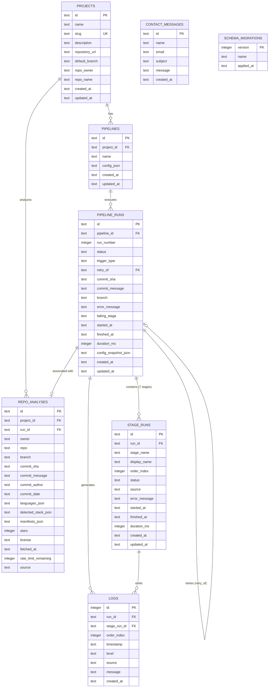

# KestrelCI Database Specification & Migration Guide

The database layer in **KestrelCI** lives in a dedicated module at `server/database/`.
Zero SQL is permitted outside `server/database/repositories/` and `server/database/migrations/`.

---

## 1. Entity Relationship Diagram (ERD)



---

## 2. Migration History

### Migration 001: Initial Schema (`001_initial_schema.sql`)
- Created `projects`, `pipelines`, `pipeline_runs`, `stage_runs`, `logs`, `contact_messages`, and `schema_migrations`.
- Established index optimizations: `idx_runs_pipeline_created`, `idx_runs_status`, `idx_stage_runs_run_order`, `idx_logs_run_order`, `idx_logs_stage`.

### Migration 002: GitHub Repository Analysis (`002_github_repo_analysis.sql`)
- Added `repo_owner` and `repo_name` columns to `projects`.
- Created `repo_analyses` table for storing full snapshots of GitHub REST API metadata:
  `id, project_id, run_id, owner, repo, branch, commit_sha, commit_message, commit_author, commit_date, languages_json, detected_stack_json, manifests_json, stars, license, fetched_at, rate_limit_remaining, source ('github_api')`.
- Added `source` column (`CHECK(source IN ('real', 'simulated'))`) to `stage_runs` and `logs`.
- Created performance indexes: `idx_repo_analyses_project_fetched`, `idx_repo_analyses_commit_sha`, `idx_pipeline_runs_commit_sha`.

---

## 3. Migration Runner How-To

KestrelCI features a tiny, robust SQL migration runner located at `server/database/migrate.js`.

### Running Migrations
To apply any unexecuted migrations:
```bash
npm run migrate
```
Or directly via node:
```bash
node server/database/migrate.js
```

### Adding a New Migration
1. Create a numbered SQL file inside `server/database/migrations/`:
   ```
   003_add_slack_notifications.sql
   ```
2. Write standard SQL DDL statements:
   ```sql
   ALTER TABLE pipelines ADD COLUMN notify_slack_webhook TEXT;
   ```
3. Run `npm run migrate`. The runner records `version = 3` into `schema_migrations` and executes the script inside a transactional block.

---

## 4. PostgreSQL Migration Path

Moving KestrelCI from SQLite to PostgreSQL is straightforward because **no SQL exists outside `server/database/repositories/`**.

### Migration Steps:
1. **Connection Layer (`server/database/connection.js`)**:
   - Replace the SQLite connection with a `pg` or `pg-promise` Pool:
     ```js
     import pg from 'pg';
     const pool = new pg.Pool({ connectionString: process.env.DATABASE_URL });
     export function getDb() { return pool; }
     ```
2. **Repository Layer (`server/database/repositories/`)**:
   - Replace `db.prepare(sql).run()` and `.all()` with `pool.query(sql, params)`.
   - Update parameter syntax from `@param` to `$1, $2, $3` or use a lightweight query builder.
3. **Engine & Services**:
   - Zero changes required in `server/engine/`, `server/routes/`, or `server/services/`.
