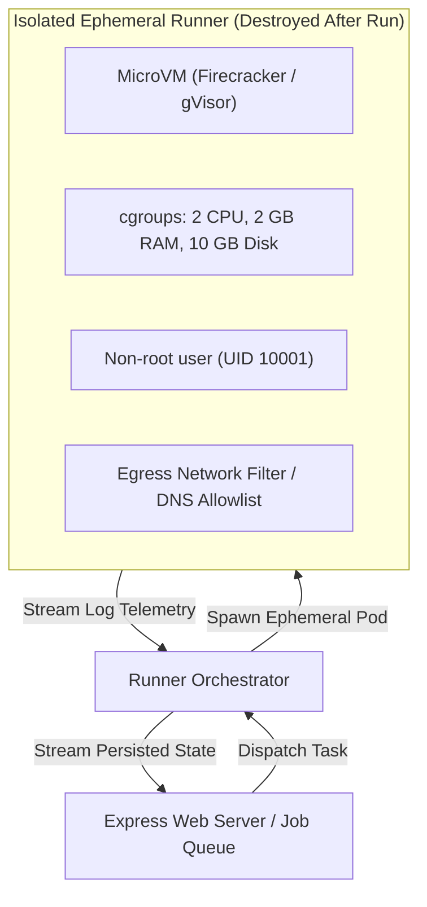
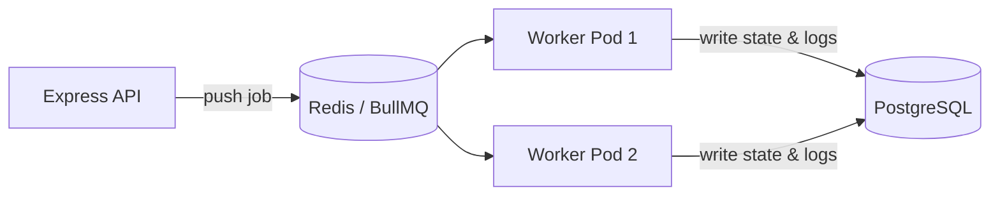

# Extending & Scaling KestrelCI

This guide provides concrete, copy-pasteable instructions for another developer to extend, customize, or scale KestrelCI.

---

## 1. How to Add a New Stage

To add an eighth stage (e.g. `e2e_integration_tests` or `perf_benchmark`):

1. **Create the Executor (`server/engine/executors/perfBenchmark.js`)**:
   ```javascript
   import { BaseExecutor } from './baseExecutor.js';

   export class PerfBenchmarkExecutor extends BaseExecutor {
     constructor() {
       super('perf_benchmark', 'Performance Benchmark', 800, 1400);
     }

     async run(context) {
       const { shouldFail, failureReason, checkCancelled } = context;
       const duration = this.getRandomDuration();
       await this.sleep(duration, checkCancelled);

       if (shouldFail) {
         return {
           status: 'failed',
           source: 'simulated',
           error: failureReason || 'Latency SLA violated: P99 280ms > 100ms threshold',
           durationMs: duration,
           logs: [
             { level: 'info', source: 'simulated', message: '[simulated] Running k6 load generation script' },
             { level: 'error', source: 'simulated', message: '[simulated] Threshold breach: P99 latency failed' }
           ]
         };
       }

       return {
         status: 'success',
         source: 'simulated',
         durationMs: duration,
         logs: [
           { level: 'info', source: 'simulated', message: '[simulated] Running 1,000 synthetic iterations' },
           { level: 'info', source: 'simulated', message: '[simulated] P95: 38ms, P99: 72ms - SLA satisfied' }
         ]
       };
     }
   }

   export default new PerfBenchmarkExecutor();
   ```

2. **Register the Executor in `server/engine/index.js`**:
   ```javascript
   import perfBenchmark from './executors/perfBenchmark.js';
   registry.register(perfBenchmark);
   ```

3. **That's it!** The engine loop automatically queries `registry.getStageDefinitions()`, and any newly dispatched runs will automatically include the new stage.

---

## 2. From Hybrid to Real Execution: Safe Containerization Requirements

Currently, KestrelCI enforces a strict **Zero Code Execution Policy**: it queries public metadata and small manifests (≤100 KB) via the GitHub REST API and simulates all execution stages.

If you choose to evolve KestrelCI into a platform that executes real user code, builds real Docker images, or runs real test suites, you **must not** run commands on the web application host server. Arbitrary code execution on the host exposes the database, API credentials, and entire filesystem.

### Non-Negotiable Security Boundaries for Real Execution



1. **MicroVM / Kernel Isolation**:
   - Use microVM technologies such as AWS Firecracker, Kata Containers, or Google gVisor (`runsc`) rather than shared standard Docker daemons.
   - Prevent container breakout vulnerabilities (`CVE-2024-21626`, dirty COW, etc.).

2. **Ephemeral, Disposable Environments**:
   - Every single pipeline run must execute in a freshly minted, pristine container/microVM that is completely destroyed immediately upon completion.
   - No filesystem state or temporary files must persist between runs.

3. **Strict Resource Constraints (cgroups v2)**:
   - Cap CPU (e.g., maximum 2 vCPUs).
   - Cap Memory (e.g., hard limit of 2 GB RAM with OOM-killer enabled).
   - Cap Disk Space (ephemeral 10 GB tmpfs / loop device).
   - Cap Process Count (PID limit: 256) to prevent fork bombs.

4. **Network Egress Isolation**:
   - Block access to internal private IP ranges (RFC 1918: `10.0.0.0/8`, `172.16.0.0/12`, `192.168.0.0/16`) and cloud metadata endpoints (`169.254.169.254`).
   - If internet access is required (e.g., for `npm install`), enforce strict egress proxies with allowlists or domain-level DNS inspection.

5. **Credential Masking & Injection**:
   - Never write tokens, private keys, or API credentials to disk files accessible by user scripts.
   - Automatically redact known secrets from stdout/stderr streams before writing to the database `logs` table.

---

## 3. Adding an API Endpoint

1. **Define Request Validator (`server/validators/myValidator.js`)**:
   ```javascript
   import { z } from 'zod';
   export const mySchema = z.object({ target: z.string().min(1) });
   ```
2. **Implement Service Method (`server/services/myService.js`)**:
   ```javascript
   export const myService = { executeAction(data) { ... } };
   ```
3. **Register Route in `server/routes/`**:
   ```javascript
   router.post('/action', validate({ body: mySchema }), (req, res) => {
     const result = myService.executeAction(req.body);
     res.json({ data: result });
   });
   ```

---

## 4. Upgrading to a Distributed Job Queue & Worker

Currently, the engine dispatches runs in-process via `setImmediate()`. To scale horizontally across multiple worker nodes:



1. Install `bullmq` and `ioredis`.
2. In `server/services/runService.js`, replace `pipelineEngine.startRunAsync(run.id)` with:
   ```javascript
   await pipelineQueue.add('execute-pipeline', { runId: run.id });
   ```
3. Create a dedicated worker entrypoint `worker.js`:
   ```javascript
   import { Worker } from 'bullmq';
   import { pipelineEngine } from './engine/index.js';

   const worker = new Worker('execute-pipeline', async (job) => {
     await pipelineEngine.executeRun(job.data.runId);
   });
   ```

---

## 5. Upgrading to Real Authentication

In the MVP, write operations require `X-API-Key: kestrel_demo_key_7f8d9a2b1c4e6f`.
To upgrade to multi-tenant user authentication:
1. Add `users` and `sessions` tables via a new SQL migration.
2. Implement JWT verification or HTTP-only session cookies in `server/middleware/auth.js`.
3. Add `user_id` foreign keys to `projects` and `pipeline_runs`.
